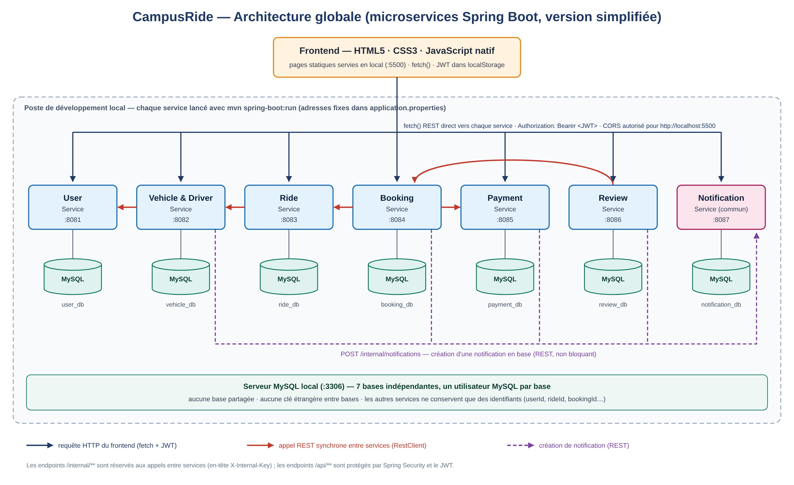

# Diagrammes CampusRide

Les vingt images PNG sont extraites du dossier technique fourni, sans modification. Leur numérotation correspond aux figures du rapport. Elles décrivent la conception prévue et ne constituent pas une preuve d’implémentation.

Le [diagramme d’architecture globale](07-architecture-globale.png) présente les composants du projet.

| Figure | Diagramme |
| --- | --- |
| 1 | [cas utilisation general](01-cas-utilisation-general.png) |
| 2 | [sequence reservation trajet](02-sequence-reservation-trajet.png) |
| 3 | [sequence publication trajet](03-sequence-publication-trajet.png) |
| 4 | [sequence verification conducteur](04-sequence-verification-conducteur.png) |
| 5 | [sequence fin trajet avis reputation](05-sequence-fin-trajet-avis-reputation.png) |
| 6 | [sequence annulation trajet](06-sequence-annulation-trajet.png) |
| 7 | [architecture globale](07-architecture-globale.png) |
| 8 | [dependances microservices](08-dependances-microservices.png) |
| 9 | [classes user service](09-classes-user-service.png) |
| 10 | [classes vehicle driver service](10-classes-vehicle-driver-service.png) |
| 11 | [etats verification vehicule](11-etats-verification-vehicule.png) |
| 12 | [classes ride service](12-classes-ride-service.png) |
| 13 | [etats trajet](13-etats-trajet.png) |
| 14 | [classes booking service](14-classes-booking-service.png) |
| 15 | [etats reservation](15-etats-reservation.png) |
| 16 | [classes payment service](16-classes-payment-service.png) |
| 17 | [etats paiement](17-etats-paiement.png) |
| 18 | [classes review service](18-classes-review-service.png) |
| 19 | [classes notification service](19-classes-notification-service.png) |
| 20 | [sequence authentification acces](20-sequence-authentification-acces.png) |
