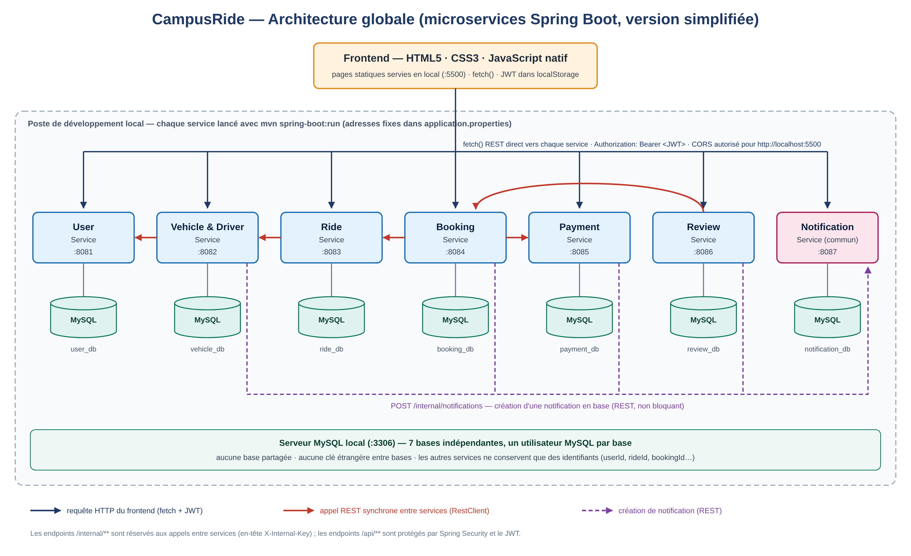

# CampusRide

Plateforme de covoiturage étudiant — **classe 4DASi16, groupe 3**.

CampusRide vise à mettre en relation des étudiants conducteurs et passagers pour publier des trajets, réserver des places, simuler des paiements et partager des avis.

## État du projet

Ce dépôt initialise la structure Maven du projet et rassemble les documents de conception. Les sept microservices sont des modules Maven Java ciblant Java 17, prêts à être complétés. Aucune logique métier, application exécutable ou configuration de base de données n’est encore implémentée. La compilation de la structure est disponible ; le lancement d’une application sera ajouté pendant le développement.

## Organisation du dépôt

```text
campusride-4dasi16-g3/
├── pom.xml                       (parent Maven)
├── Backend/
│   ├── pom.xml                   (agrégateur des 7 microservices)
│   ├── user-service/
│   ├── vehicle-driver-service/
│   ├── ride-service/
│   ├── booking-service/
│   ├── payment-service/
│   ├── review-service/
│   └── notification-service/
├── Frontend/
│   ├── pages/
│   ├── css/
│   ├── js/pages/
│   └── assets/images/
├── Documentation/
│   ├── Presentation/
│   │   └── CampusRide_Presentation_Seance4_FR.pptx
│   ├── Diagrams/
│   │   ├── Diagrammes-de-classes/ (7 diagrammes)
│   │   ├── 07-architecture-globale.png
│   │   └── ... 12 autres diagrammes et leur index
│   └── CampusRide_Rapport_technique_v3.docx
├── .gitattributes
├── .gitignore
└── README.md
```

Les fichiers `.gitkeep` permettent à Git de conserver les dossiers encore vides.

Chaque dossier de microservice contient son propre `pom.xml` et les répertoires Maven `src/main/java`, `src/main/resources` et `src/test/java`. Le frontend et la documentation restent des dossiers du dépôt, hors du build Java.

## Vérifier la structure Maven

Prérequis : un JDK 17 ou supérieur et Maven 3.9 ou supérieur.

Depuis la racine du dépôt :

```bash
mvn clean verify
```

Pour construire un seul microservice et ses parents :

```bash
mvn -pl Backend/user-service -am clean verify
```

Les modules produisent des JAR de structure dans leurs dossiers `target/`. Ils ne contiennent pas encore de code applicatif ni de tests. Les dépendances Spring Boot seront ajoutées lors de l’implémentation des services.

## Architecture prévue

Le projet comprend six microservices métier et un service commun de notification. Chaque service dispose de sa propre base MySQL et communique par API REST. Le frontend prévu utilise HTML, CSS et JavaScript natif avec Fetch API.



| Microservice | Responsabilité | Port prévu | Base prévue |
| --- | --- | --- | --- |
| User | Comptes, authentification et rôles | 8081 | user_db |
| Vehicle & Driver | Véhicules et validation des conducteurs | 8082 | vehicle_db |
| Ride | Trajets et places disponibles | 8083 | ride_db |
| Booking | Réservations et annulations | 8084 | booking_db |
| Payment | Paiements simulés et remboursements | 8085 | payment_db |
| Review | Avis et réputation | 8086 | review_db |
| Notification | Notifications dans l’application | 8087 | notification_db |

Technologies backend prévues : Java 17, Spring Boot 3, Maven, Spring Security, BCrypt, JWT et MySQL 8. Le frontend est prévu sur le port local 5500. Ces choix décrivent la cible de développement.

## Documents du projet

- [Présentation de la séance 4](Documentation/Presentation/CampusRide_Presentation_Seance4_FR.pptx).
- [Diagramme d’architecture globale](Documentation/Diagrams/07-architecture-globale.png).
- [Principaux diagrammes et index complet](Documentation/Diagrams/README.md).
- [Dossier technique Word](Documentation/CampusRide_Rapport_technique_v3.docx).

## Équipe et encadrement

Équipe : Yesmine Chourou, Ines Mzoughi, Ahmed Aatrous, Adam Miniaoui, Aziz Soltani et Amine Bel Hadj.

Encadrant : M. Ghassen Hamouda.

## Ouvrir le projet dans IntelliJ IDEA

1. Cloner le dépôt :

   ```bash
   git clone https://github.com/Adamminiaoui/campusride-4dasi16-g3.git
   ```

2. Dans IntelliJ IDEA, choisir **File > Open**, sélectionner le `pom.xml` à la racine et l’ouvrir comme projet.
3. Si le dossier est déjà ouvert, faire un clic droit sur le `pom.xml` racine et choisir **Add as Maven Project** ou utiliser **Load Maven Project** si cette notification apparaît.
4. IntelliJ importe le parent, l’agrégateur Backend et les sept modules. Choisir un JDK 17 ou supérieur ; le niveau de compilation Java 17 est défini dans le parent Maven.

## Collaboration

Créer une branche par fonctionnalité ou microservice, puis proposer une pull request vers `main`. Ne pas versionner les mots de passe, jetons ou fichiers de configuration personnels.

L’accès de l’enseignant se gère dans les paramètres GitHub du dépôt : **Settings > Collaborators**. Une invitation doit être acceptée par son destinataire pour devenir effective.
